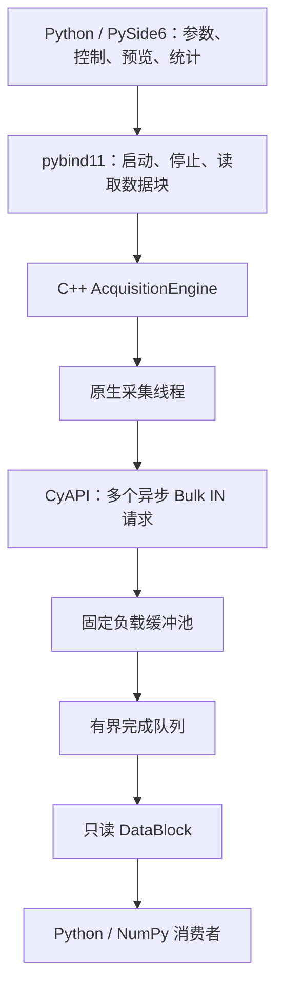

# FX3 CyAPI：Python 界面与 C++ 采集内核

面向 FX3 的 Bulk IN 数据采集工程：**Python / PySide6 负责界面与业务逻辑，C++ 负责异步 USB 请求、缓冲池和采集线程，pybind11 提供粗粒度接口。** Python 无需调度每个 USB 包。

当前支持原始字节流采集、模拟采集和实时统计。ADC 帧解析、通道映射、电压标定、设备控制命令和文件录制尚未实现。

> 本仓库仅包含功能实现、测试及构建文件，不包含 Infineon/Cypress 官方源码、参考例程、驱动或预编译库。Windows 构建需自行获取官方 CyAPI 源码，并通过 `CYAPI_DIR` 指定路径。Windows 下的模拟模式也需要先编译该依赖。

## 架构



- USB 传输使用 `BeginDataXfer()`、`WaitForXfer()`、`FinishDataXfer()`，保持多个请求在途。
- 阻塞接口显式释放 GIL；原生采集线程不调用 Python 回调。
- 数据块支持只读 buffer protocol，可通过 `memoryview()` 或 `np.frombuffer()` 直接访问。
- GUI 生命周期操作在 Qt 工作线程执行，主线程定时读取统计和显示预览。

## Windows 快速开始

### 1. 准备构建工具与官方源码

需要 Windows x64、Conda/Miniforge、MSVC x64 编译工具和 Windows SDK。Visual Studio Installer 中选择“使用 C++ 的桌面开发”。CMake、Ninja 和 Python 依赖由环境配置安装。

从 [Infineon FX3 SDK 页面](https://softwaretools.infineon.com/tools/com.ifx.tb.tool.ezusbfx3sdk) 获取 SDK/USB Suite；如需源码，可使用官方 [CYUSB3 USB-Suite Source 下载页](https://www.infineon.com/gated/infineon-cyusb3-usb-suite-source-software-en_b546b9a1-74d7-4a44-82e7-aaa94477efbb)。下载可能需要登录。

`CYAPI_DIR` 应指向以下层级，而不是 ZIP 解压根目录：

```text
<官方源码目录>/CyAPI_Library_Source/CyAPI/library/cpp/
├─ src/CyAPI.cpp
└─ inc/CyAPI.h
```

### 2. 克隆、创建环境并安装

以下命令在 **Miniforge Prompt / Windows CMD** 中执行。将 `CYAPI_DIR` 的示例路径替换为实际位置：

```bat
git clone https://github.com/ski-wei/fx3-cyapi.git
cd fx3-cyapi
conda env create -f environment.windows.yml
conda activate fx3-cyapi

set "CYAPI_DIR=E:\SDK\CyUSB3_USB_Suite_Source\CyAPI_Library_Source\CyAPI\library\cpp"
scripts\build_windows.cmd
```

构建脚本会查找 MSVC、编译并安装扩展，然后运行测试和 Python 依赖检查。脚本默认 Miniforge 位于 `%USERPROFILE%\miniforge3`。

使用其他 Conda 安装位置时，可在 **x64 Developer Command Prompt** 中激活自己的环境、设置 `CYAPI_DIR`，再手动执行：

```bat
python -m pip install ".[test]"
python -m pytest -q
python -m pip check
```

已有 `fx3-cyapi` 环境时直接激活，按需运行 `conda env update -f environment.windows.yml`，无需重复创建。每次新开终端构建时都要重新设置 `CYAPI_DIR`。也可以将路径作为 CMake 参数传入：

```bat
python -m pip install ".[test]" -C "cmake.define.CYAPI_DIR=E:/SDK/CyUSB3_USB_Suite_Source/CyAPI_Library_Source/CyAPI/library/cpp"
```

为兼容本地开发，构建还会尝试仓库工作区内的本地 `CyUSB3_USB_Suite_Source/.../library/cpp` 目录；该目录被 Git 和源码发行包排除，不会上传。

### 3. 启动模拟采集

```bat
python -m fx3_cyapi.gui
```

也可使用入口命令 `fx3-monitor`。界面默认勾选“模拟采集”，点击“开始”即可验证界面和原生采集链路，无需连接设备。

命令行测试：

```bat
python scripts/smoke_acquisition.py --seconds 3
```

模拟模式显示的速率是本机模拟数据处理速率，不能作为 FX3 实测带宽。界面显示降采样后的原始 `uint8` 字节，横轴不是采样时间，纵轴不是电压；周期性数据被固定步长抽点后可能显示为水平线。

## Python 调用

```python
import numpy as np
from fx3_cyapi import AcquisitionConfig, AcquisitionEngine

with AcquisitionEngine() as engine:
    engine.open(index=0, endpoint=0x81, simulated=True)

    config = AcquisitionConfig()
    config.block_size = 1024 * 1024
    config.queue_depth = 8
    config.queue_capacity = 16
    config.pool_extra = 8
    config.timeout_ms = 1000
    engine.configure(config)
    engine.start()

    block = engine.read_block(timeout_ms=1000)
    if block is not None:
        data = np.frombuffer(block, dtype=np.uint8)  # 零拷贝，只读
        print(block.sequence, block.size, data[:8])
        saved = data.copy()  # 需要长期保存或修改时复制
        del data, block     # 释放原生缓冲区的占用

    engine.stop()
    stats = engine.stats()
    print(stats.received_bytes, stats.dropped_blocks, stats.last_error)
```

| 接口 | 行为 |
|---|---|
| `list_devices()` | 返回默认 CyUSB3 接口 GUID 下可打开设备的信息；会短暂打开设备，采集停止时使用 |
| `open(index, endpoint, simulated)` | 打开设备或模拟后端；真实采集必须指定实际 Bulk IN 端点 |
| `configure(config)` | 配置块大小、在途请求数、完成队列和超时；应先打开设备并停止采集 |
| `start()` | 启动原生线程，等待初始请求入队 |
| `read_block(timeout_ms)` | 返回 `DataBlock`；等待超时或正常结束且队列为空时返回 `None` |
| `stats()` | 返回线程安全的统计快照 |
| `stop()` | 停止并等待线程退出，保留完成队列供读取尾部数据；可重复调用 |
| `close()` | 停止、关闭设备并清空完成队列；退出 `with` 时自动执行 |

采集出错时，`read_block()` 先返回队列中已完成的数据，队列耗尽后抛出 `RuntimeError`。错误停止后仍需调用 `stop()`，再配置或重启。`configure()` 不接受仍有工作线程待回收的状态。

`DataBlock.size` 是实际完成长度，可能小于请求大小。`sequence` 是主机完成顺序号；丢弃或未入队的零长度完成可能造成间断。`timestamp_ns` 是主机单调时钟完成时间，不是设备采样时间。

## 参数与数据所有权

| 参数 | 默认值 | 约束 / 含义 |
|---|---:|---|
| `block_size` | 1 MiB | 不超过 16 MiB，且为选定端点最大包长的整数倍 |
| `queue_depth` | 8 | 1–64 个在途请求 |
| `queue_capacity` | 16 | 1–1024 个待消费数据块 |
| `pool_extra` | 8 | 1–1024 个额外缓冲区，供已导出的数据块占用 |
| `timeout_ms` | 1000 | 1–60000 ms，请求超时后停止采集 |

负载池大小为：

```text
(queue_depth + queue_capacity + pool_extra) × block_size
```

默认配置为 **32 MiB**，每个引擎上限为 **512 MiB**。该限制不包括驱动、CyAPI 请求上下文、Python 主动复制或 GUI 内存。CyAPI direct 模式仍会分配请求上下文，整个传输流程并非零分配。

队列满或池无空闲缓冲区时，内核丢弃**新完成的数据块**并复用该请求的负载缓冲区，累积 `dropped_blocks` 和 `dropped_bytes`。已导出给 Python 的数据不会被覆盖。该计数只统计主机应用丢弃；链路及设备端完整性需通过固件帧序号等机制验证。

`DataBlock` 及其 NumPy/memoryview 视图持有原生内存的共享所有权，关闭甚至销毁引擎后仍然有效。长期保留视图会耗尽池，并可能使整代池继续存活。重新配置、重新启动或重新打开前，必须释放上一代所有块和视图；需要保留的数据应先复制。

停止时，原生线程通过 `CancelIoEx` 取消在途 I/O，等待请求进入终态，再调用 `FinishDataXfer()` 回收上下文，最后释放事件和负载缓冲区。常规停止检查间隔为 20 ms，但驱动若不完成取消，等待可能持续；不通过强制释放在途内存实现退出。

## 真实设备接入

1. 安装与 Windows x64、设备 VID/PID 匹配的 CyUSB3 驱动，并确认设备状态正常。
2. 确认驱动 INF 的接口 GUID 与默认 `CYUSBDRV_GUID` 一致。当前尚未暴露自定义 GUID 和 alternate setting 配置。
3. 确认固件已经开始发送数据，并选择实际 Bulk IN 端点。`0x81` 只是示例，程序不会自动发送业务启动命令或烧写固件。
4. 运行短时读取，检查数据内容和实际长度：

```bat
python scripts/smoke_acquisition.py --hardware --index 0 --endpoint 0x81 --seconds 3
```

随后使用带帧序号的固件数据验证连续性、短包、吞吐、超时、拔插和停止/重启。界面是监视器，每 50 ms 最多取 32 个整块，仅保留最多 1024 个预览字节；它不保证保存全部数据。完整采集需要专门消费者，或后续增加原生解析与落盘。

## 测试与打包

```bat
python -m pytest -q
python -m build --wheel
```

wheel 生成在 `dist/`，需匹配 CPython ABI 和 Windows 架构。`scripts\package_windows.cmd` 可完成打包和测试，并将 JUnit 报告写入 `artifacts/test-results.xml`。构建产物、测试报告和官方参考材料均不纳入版本控制。

截至 2026-11-06，Windows x64 / Python 3.12.16 / VS2026 18.11.3 / MSVC 19.51.36260 / Windows SDK 10.0.28000.0 下构建通过，**21 项测试通过**，覆盖模拟数据、只读视图及跨析构存活、固定池溢出、并发读取、GIL、故障、请求超时和 Qt 窗口生命周期。不含官方源码的干净副本也已通过外部 `CYAPI_DIR` 构建验证。

**尚未进行真实 FX3 吞吐、拔插和驱动取消实测。** Linux 构建仅提供模拟后端，不能通过 Linux/WSL Python 调用 Windows CyAPI。

## 代码目录

| 路径 | 内容 |
|---|---|
| [`native/engine.cpp`](native/engine.cpp) | 原生线程、固定池、有界队列、统计和模拟后端 |
| [`native/usb_windows.cpp`](native/usb_windows.cpp) | CyAPI 异步请求与取消回收 |
| [`native/bindings.cpp`](native/bindings.cpp) | 粗粒度接口、GIL 和只读 buffer protocol |
| [`python/fx3_cyapi/gui.py`](python/fx3_cyapi/gui.py) | PySide6 界面与预览 |
| [`scripts/`](scripts/) | 构建、打包和命令行采集入口 |
| [`tests/`](tests/) | 内核与 GUI 测试 |

相关文档：[pybind11 GIL](https://pybind11.readthedocs.io/en/stable/advanced/misc.html)、[buffer protocol](https://pybind11.readthedocs.io/en/stable/advanced/pycpp/numpy.html)。官方源码和驱动应按其许可单独获取与使用。
